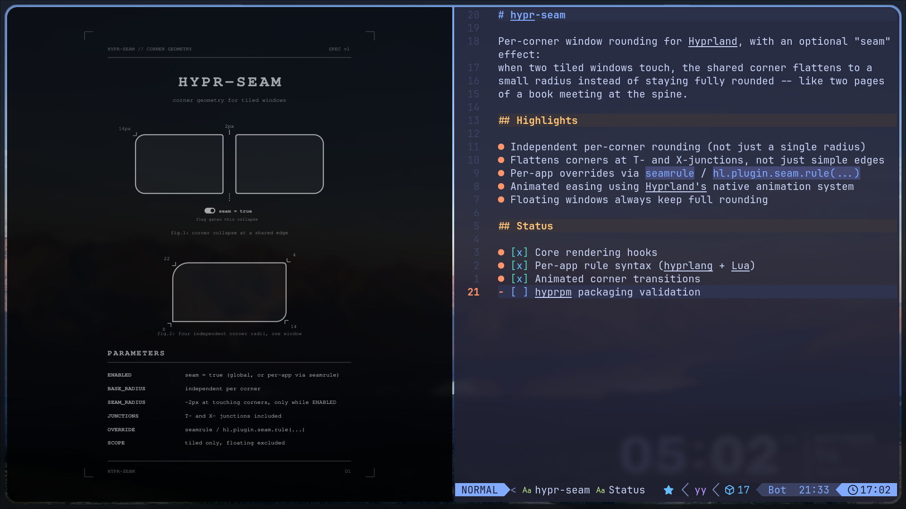

# hypr-seam


A Hyprland plugin that adds a seam effect to tiled windows, flattening the corners where windows meet so your layout feels like one continuous shape instead of a bunch of rounded boxes.

Also supports per-corner and per-app rounding for more control over your setup.


## Demo


https://github.com/user-attachments/assets/b4e92a3d-2223-406b-b80d-d5382d2eec14

## Requirements

- Hyprland, built and tested against the 0.57.0 internal ABI. The plugin
  hooks an internal, version-unstable function (`createFunctionHook`, also
  used by plugins like `hy3`), so a Hyprland update that changes that
  function's signature needs a matching plugin update.
- `decoration:rounding = 0` set globally. This plugin fully replaces
  native corner rendering; leaving it on conflicts with the plugin's own
  rounding.

## Installation

### Via hyprpm

The repo ships an `hyprpm.toml` manifest, so it can be added directly:

```sh
hyprpm add https://github.com/misaid/hypr-seam
hyprpm enable hypr-seam
```

`hyprpm` builds the plugin using the manifest's build script (`make all`,
then the resulting `build/libhypr-seam.so` is copied to `hypr-seam.so`).

`hyprpm enable` only loads it for the current session. To load it on every
Hyprland start, add this to your config:

```lua
hl.on("hyprland.start", function()
    hl.exec_cmd("hyprpm reload -n")
end)
```

(`-n` suppresses the "unstable plugin" notification on every launch.) One
`hyprpm reload -n` line covers every plugin enabled through hyprpm.

### Manual build

The repo also includes a plain `Makefile` that wraps a `meson`/`ninja`
build, for building outside `hyprpm`:

```sh
git clone https://github.com/misaid/hypr-seam
cd hypr-seam
make all
```

This produces `build/libhypr-seam.so`. Load it for the running Hyprland
session with:

```sh
hyprctl plugin load "$(pwd)/build/libhypr-seam.so"
```

or load it on every start the same way, from an
`hl.on("hyprland.start", ...)` block:

```lua
hl.on("hyprland.start", function()
    hl.exec_cmd("hyprctl plugin load /path/to/build/libhypr-seam.so")
end)
```

## Configuration

### Example

Hyprland's Lua config DSL, covering the common options:

```lua
hl.config({
    plugin = {
        seam = {
            enabled = true,
            rounding = 12,
            seam_radius = 2,
            animate = true,
            animation_speed = 300,
            round_borders = true,
            round_shadows = true,
            -- needed for GPU-accelerated apps (Firefox-based browsers, etc.)
            -- whose content draws into a subsurface
            force_round_risky_surfaces = true,
        },
    },
})

hl.plugin.seam.rule({ class = "^(kitty)$", rounding = { 4, 4, 22, 22 } })
hl.plugin.seam.rule("seam 0, class:^(foot)$")
```

A fuller version of this file, with every option set to its default and
commented, lives at [`examples/seam.lua`](examples/seam.lua).

### Global options

All values live under the `plugin:seam:` prefix.

| Key | Type | Default | Meaning |
|---|---|---|---|
| `plugin:seam:rounding` | int | `22` | Uniform base radius used for any corner without its own `rounding_*` override. |
| `plugin:seam:rounding_topleft` | int | = `rounding` | Base top-left corner radius. |
| `plugin:seam:rounding_topright` | int | = `rounding` | Base top-right corner radius. |
| `plugin:seam:rounding_bottomleft` | int | = `rounding` | Base bottom-left corner radius. |
| `plugin:seam:rounding_bottomright` | int | = `rounding` | Base bottom-right corner radius. |
| `plugin:seam:rounding_power` | float | `2.0` | Squircle exponent for the corner curve, matching Hyprland's native default look. |
| `plugin:seam:enabled` | bool | `false` | Global master switch for the seam effect. |
| `plugin:seam:seam_radius` | int | `2` | Radius a corner collapses to once it's flagged as touching a neighboring tiled window. |
| `plugin:seam:tolerance` | int (px) | `-1` | Max gap between two window edges still counted as touching. `-1` (default) derives it from `general:gaps_in`; set a number to override. |
| `plugin:seam:animate` | bool | `true` | Eases a corner's radius between its base and seam values instead of snapping. |
| `plugin:seam:animation_speed` | float (ms) | `300` | Duration of that easing transition. |
| `plugin:seam:animation_curve` | string | `"default"` | Name of a bezier curve already registered via `hl.curve(...)`. |
| `plugin:seam:force_round_risky_surfaces` | bool | `false` | Also round a window's subsurfaces where they reach the window's own corners. Turn this on if Firefox-based browsers (Firefox, Zen, ...) keep square corners. See below. |
| `plugin:seam:round_borders` | bool | `false` | Round the native border to match the window's live corner radii, seam flattening included. Needs `general:border_size > 0`. |
| `plugin:seam:round_shadows` | bool | `false` | Round the native drop shadow to match the window's live corner radii, seam flattening included. Needs `decoration:shadow:enabled = true`. |

Base corner radii resolve per window: a matching `seamrule rounding`
override, or else the four global `rounding_*` values. The seam flag
resolves the same way, via `seamrule seam` or else `plugin:seam:enabled`.
Floating windows always skip seam resolution and render with base
rounding only.

### Per-app rules (`hl.plugin.seam.rule`)

Hyprland's plugin API has no hook into `windowrulev2`, so `hypr-seam`
parses its own rules via `hl.plugin.seam.rule(...)`, using the same
`class:`/`title:` match syntax. It takes either a rule string:

```
rounding <tl> <tr> <bl> <br>, <match>
seam <0|1>, <match>
```

or an equivalent table. Examples:

```lua
hl.plugin.seam.rule("rounding 4 4 22 22, class:^(kitty)$")      -- sharp top corners, rounded bottom
hl.plugin.seam.rule("rounding 0 0 0 0, class:^(discord)$")      -- fully square, regardless of global rounding
hl.plugin.seam.rule("rounding 16 16 16 16, class:^(obsidian)$") -- its own uniform radius, independent of the global one
hl.plugin.seam.rule("seam 1, class:^(mpv)$")                    -- always flattens, even if plugin:seam:enabled = false
hl.plugin.seam.rule("seam 0, class:^(foot)$")                   -- opt out even if plugin:seam:enabled = true
hl.plugin.seam.rule("seam 0, title:^Picture-in-Picture$")       -- match by title instead of class

hl.plugin.seam.rule({ class = "^(kitty)$", rounding = { 4, 4, 22, 22 } })
hl.plugin.seam.rule({ title = "^Picture-in-Picture$", seam = false })
```

`rounding` rules and `seam` rules are independent: an app can have one
rounding rule and one seam rule for the same `class:`/`title:` match, and
both apply. Later rules win on conflict, same as `windowrulev2`.

A malformed rule, in either form, shows up as a config error with a
file/line reference, the same way Hyprland reports its own config
mistakes.

## Scope and limitations

- hypr-seam only rounds a window's main surface by default, not its
  subsurfaces. GPU-accelerated apps like Firefox-based browsers (Firefox,
  Zen, and others) draw into a subsurface that covers the main surface
  exactly, so the rounding is there but hidden and the window looks
  square. Set `plugin:seam:force_round_risky_surfaces = true` to also
  round subsurfaces where they reach a window's corners; a subsurface
  that doesn't reach a corner, like an embedded video, is never touched.
  This is off by default since it changes how other apps draw their
  subsurfaces, and it has only been tested against Firefox. During a
  resize animation the subsurface can briefly lag the window box, showing
  square corners for a few frames.
- Border and shadow rounding (`plugin:seam:round_borders`,
  `plugin:seam:round_shadows`) are off by default. They use the same
  per-corner re-render technique as window content, applied to Hyprland's
  own border and shadow passes. Until enabled, a window's border and
  shadow stay native (square, if `decoration:rounding = 0`).
- With `plugin:seam:round_shadows = true`, a small wedge of background
  shows through at the tip of each rounded corner, inside the shadow's
  blur range. Hyprland's shadow cutout (the hole the window sits in) is
  sized from the window's native rounding, which this plugin forces to
  0, so the cutout stays square no matter what radius the corner itself
  uses. Removing the cutout closes the wedge but lets window content
  leak through the corner instead, visible as a dark square on
  GPU-accelerated clients like Ghostty and Zen Browser, so hypr-seam
  doesn't do that. A real fix needs the cutout to use hypr-seam's live
  per-corner radius, which means patching Hyprland's own
  `renderRoundedShadow`; nothing reachable from plugin code controls it.
